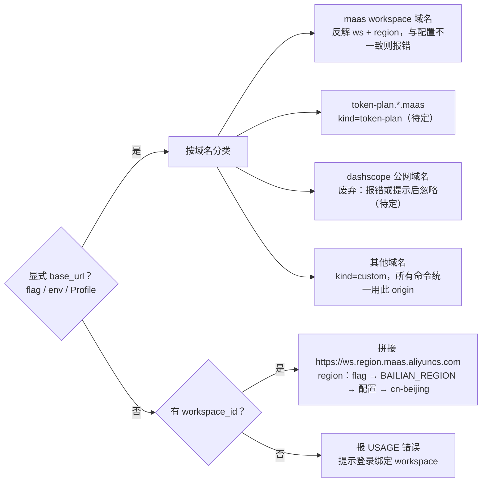

# bl CLI 模型端点统一改造方案（Workspace + Region 专属域名）

> 日期：2026-11-09 · 状态：讨论稿

## 背景与目标

结论：bl CLI 的模型服务地址统一收敛为 `https://{workspace_id}.{region}.maas.aliyuncs.com`，以 workspace + region 为唯一事实源，废弃 `dashscope*.aliyuncs.com` 公共域名的默认回落。本文为讨论稿，所有未验证的判断都在「风险与拿不准的地方」中标出。

- 背景：dashscope 公共域名（`dashscope.aliyuncs.com` / `dashscope-intl` / `dashscope-us` / `cn-hongkong.dashscope`）将被废弃，后续统一使用业务空间专属 Host，例如 `llm-xxx.cn-beijing.maas.aliyuncs.com`。
- 目标 1：所有模型域请求（推理、生成、任务查询、上传等）在无显式覆盖时都打到 workspace 专属 Host，不再静默回落到 dashscope。
- 目标 2：同一条命令、同一份配置下，所有子能力（chat、知识库、记忆、Sandbox、安全中心等）指向同一个 workspace 与地域，消除当前「一半打 A 一半打 B」的不一致。
- 目标 3：用户配置以 `--workspace-id` + `--region` 为主，保留 `--base-url` 兼容粘贴完整链接与预发 / 代理 / mock 场景。
- 非目标（待确认）：控制台 OpenAPI 域名（`modelstudio.*.aliyuncs.com`、`bailian.cn-beijing.aliyuncs.com`）、`x-dashscope-*` 请求头、`DASHSCOPE_*` 环境变量命名，本期不在废弃范围内。

代码基线：`modelstudioai/cli` main 分支 `cadc301d`（v2.8.4）。

## 现状分析

当前存在两套互不感知的地址机制，且各命令对二者的取舍规则不同。

### 机制 A：base_url 链（模型域）

- 优先级：`--base-url` > `DASHSCOPE_BASE_URL` > Profile `base_url` > 内置 `REGIONS.cn`（`https://dashscope.aliyuncs.com`）。实现在 `packages/core/src/auth/resolver.ts:55-69`。
- `normalizeModelBaseUrl` 只保留 origin，丢弃 path / query（`packages/core/src/config/model-base-url.ts`）。
- `Client.url(path, defaultBaseUrl?)`（`packages/core/src/client/client.ts:140`）允许命令在「未显式配置」时自带默认 origin，Prime、决策、Batch 依赖这个分支。

### 机制 B：workspace_id 链（workspace 域）

- `workspace_id` 优先级：`--workspace-id` > `BAILIAN_WORKSPACE_ID` > Profile `workspace_id`（`packages/core/src/config/loader.ts:319`）。
- `workspaceEndpoint()`（`packages/core/src/client/endpoints.ts:15`）写死 `cn-beijing`，知识库 / 记忆 / 检索问答 / RAG 管理 / ParseX 通过它拼绝对 URL，约 60 处调用。
- `agentStudioHost()`（:237）、`sandboxBaseUrl()`（:465）再各拼一遍同形态域名；`workspaceMaaSBaseUrl(ws, region)`（:213）是唯一带 region 参数的版本（Prime、决策模型使用）。

### 运行时取舍：同一份配置可能打到两个空间

| 命令族 | base_url 与 workspace_id 同时存在时 |
| --- | --- |
| Prime 模式 chat / video、decision、sandbox | base_url 优先，workspace_id 不参与拼接 |
| 安全中心 | base_url 非 dashscope 公网时优先，否则用 workspace_id |
| 知识库 / 记忆 / 检索问答 / RAG 管理 | 忽略 base_url，只用 workspace_id，地域固定 cn-beijing |
| 其余模型调用（图片、语音、普通 chat 等） | 只用 base_url |

例：配置 `workspace_id=ws-A`，又传 `--base-url https://ws-B.ap-southeast-1.maas.aliyuncs.com`，则 chat 打 ws-B 新加坡，知识库打 ws-A 北京，全程无提示。配置文件层面两个键互不覆盖：`config set base_url` 与 `auth login --base-url` 只写 `base_url`。

### 写死或依赖 dashscope 公网域名的位置

| 位置 | 用途 | 备注 |
| --- | --- | --- |
| `core/config/schema.ts:3` `REGIONS` | cn / us / intl 三个公网域名 | 默认回落源头 |
| `core/client/endpoints.ts:80` | 同步 Batch Chat `batch.dashscope.aliyuncs.com` | 独立 Host |
| `core/client/endpoints.ts:337` | 自定义模型导入 | 注释写明 workspace 域名返回 404 |
| `commands/cmodel/shared.ts` | cmodel 系列 | 文案说固定走公网 |
| `commands/mcp/connect.ts:107` | MCP 注册地址 | 直接用 `REGIONS.cn` |
| `core/files/upload.ts:44` | 临时上传地域判断 | 已支持 maas 域名的 cn-beijing / ap-southeast-1 |
| `core/auth/refresh-token.ts:32` | 从域名推导控制台地域 | 正则反解 |
| `core/batch/api.ts:66` | 拦截实时公网域名走 Batch | 正则 |
| `core/client/security.ts:15` `isDashScopeGateway` | 判定 base_url 是否「默认值」 | 依赖 REGIONS |
| `commands/auth/login-api-key.ts:65` | 登录探测 4 个公网域名 | 已有 6 个 workspace 地域探测列表 |
| `commands/config/show.ts:70`、`config/ui.ts:252` | 展示 / 写入默认 base_url | 用户可见 |
| `commands/config/agent/*`、`config/set.ts` | 给 Claude Code / Codex 等写配置的示例 | `/apps/anthropic`、`/compatible-mode/v1` |
| `core/advisor/engine/debug-loop.ts:5` | 调试脚本 | 低优先 |

### 其他相关

- Token Plan：`token-plan.{region}.maas.aliyuncs.com`（`core/config/profile-presets.ts:17`），同为 maas 域名但前缀不是 workspace。
- 预发：ParseX 识别 `*.cn-beijing.pre-maas.aliyuncs.com`（`endpoints.ts:55`）。
- dsh 插件：`bailian-kb-dsh`、`bailian-memo-dsh` 各自写死 `cn-beijing.maas.aliyuncs.com`，按约定不依赖 core。
- 文档与测试：skills / README / docs 约 6 个文件、测试约 48 个文件提及 dashscope（grep 统计，未逐一阅读）。

## 目标设计

核心：在 core 引入唯一的 `ModelEndpoint` 解析结果，所有命令从它取 origin、workspace 与 region；配置里存结构化字段，完整 URL 由程序推导。

### ModelEndpoint

| 字段 | 含义 |
| --- | --- |
| `origin` | 最终请求 origin，如 `https://llm-xxx.cn-beijing.maas.aliyuncs.com` |
| `kind` | `workspace`（专属 Host）/ `token-plan` / `custom`（预发、代理、mock） |
| `workspaceId` | kind=workspace 时必有；custom 时可来自配置，仅作请求参数 |
| `region` | 云地域 ID，如 `cn-beijing` / `ap-southeast-1` |
| `source` | `flag` / `env` / `config`，用于 `config show` 与报错提示 |

### 解析优先级

1. 显式 `base_url`（`--base-url` > `DASHSCOPE_BASE_URL` > Profile `base_url`）：
   1. maas workspace 域名 → 反解 ws + region，与已配置的 workspace / region 比对（见冲突规则）。
   2. `token-plan.{region}.maas` → kind=token-plan。
   3. dashscope 公网域名 → 废弃处理（报错或提示后忽略，待定）。
   4. 其他 → kind=custom，所有命令统一用此 origin。
2. 无显式 base_url：`workspace_id`（flag > `BAILIAN_WORKSPACE_ID` > config）+ `region`（flag > `BAILIAN_REGION` > config > 默认 `cn-beijing`）拼接。
3. 两者都没有：报 `USAGE`，提示 `auth login --workspace-id` 或 `config set workspace_id`。不再回落 dashscope。

显式 base_url 按域名形态分流；未配置时只有 workspace + region 一条路，缺 workspace 直接报错。

### 配置与输入方式

- 新增配置字段 `region`、环境变量 `BAILIAN_REGION`、全局 flag `--region`（与 `console_region` 分开，未配时可用其兜底）。
- 主推 `--workspace-id` + `--region`：与知识库等已有的 workspace_id 保持单一事实源；region 可供上传、刷新 token、服务地域校验直接使用；报错更精确；域名规则集中一处；对 Agent 更友好。
- 保留 `--base-url`：粘贴控制台完整链接时自动拆回 ws + region 存储；非 maas 域名按 custom 原样存储；兼容现有脚本。
- 落盘规则：maas 域名不再单独存 `base_url`，只存 `workspace_id` + `region`；仅 custom / token-plan 存 `base_url`。
- `config show` 同时展示 workspace_id、region 与推导出的 URL，标注来源。

### 冲突规则

- 一次性命令同时带 `--base-url`（maas）与不一致的 `--workspace-id` / `--region` 或配置值 → `USAGE` 报错，提示改用 `--workspace-id`。不静默取一。
- `auth login` / `config set` 传入不同空间 → 视为显式切换，同时更新 workspace_id 与 region 并提示一次（是否需 `--force` 待定）。
- custom origin 下，workspace_id 只作请求参数，不参与拼域名。
- 服务自带地域约束（如 Sandbox 仅 cn-beijing）：region 不在支持列表时明确报错，而不是拼出一个 404 的域名。

## 受影响范围

预估改动约 35 个源文件 + 约 48 个测试文件（grep 估算，需 PoC 校准）。

| 层 | 模块 | 改动要点 |
| --- | --- | --- |
| core | `config/schema.ts`、`config/loader.ts`、新增 `config/model-endpoint.ts` | 新增 `region` 字段与解析；`REGIONS` 降级为旧域名识别表 |
| core | `auth/resolver.ts`、`auth/types.ts`、`auth/store.ts` | `resolveModelBaseUrlState` → `resolveModelEndpoint`；登录落盘字段 |
| core | `client/client.ts`、`client/endpoints.ts`、`client/security.ts` | Client 持有 endpoint；`workspaceEndpoint` 等改为接收 endpoint；合并 3 个重复拼接函数 |
| core | `files/upload.ts`、`auth/refresh-token.ts`、`batch/api.ts` | 地域判断改读 `endpoint.region` |
| runtime | `middleware.ts`、`create-cli.ts`、`error-handler.ts` | 注入 endpoint；新增 `--region` 全局 flag；报错文案 |
| commands | `auth/login-api-key.ts`、`auth/login.ts` | 登录必须绑定 workspace，地域探测 |
| commands | `config/set.ts`、`show.ts`、`ui.ts`、`config/agent/*` | 展示与写入、示例 URL |
| commands | `shared/prime.ts`、`decision/shared.ts`、`sandbox/*`、`security/shared.ts`、`parsex/shared.ts`、`knowledge/shared.ts` | 改用统一 endpoint，删除各自兜底 |
| commands | `mcp/connect.ts`、`cmodel/*`、自定义模型导入、`managed-agent/_engine/credentials.ts` | 取决于公网专属 API 的验证结果 |
| 入口 | `packages/kscli` | 跟随 core 接口变更 |
| 插件 | `bailian-kb-dsh`、`bailian-memo-dsh` | `endpointHost` 改为由 region 生成，仍不依赖 core |
| 文档 | `skills/*`、README、INSTALL、`docs/agents/*`、CHANGELOG | `pnpm run sync:skill-assets` 重新生成 reference |
| 测试 | 单测、输出契约、E2E | 解析矩阵、迁移、域名反解、冲突报错 |

按 AGENTS.md 场景索引，本次同时命中「配置项扩展」「URL / 渠道变更」「鉴权扩展」「选项变更」「错误文案变更」「输出契约」「安装文档」「dsh 插件」八个清单，实施时逐一走。

## 旧配置兼容与迁移

原则：能确定就自动迁移并提示一次，不能确定就明确报错并给出修复命令，绝不静默回落 dashscope。

| 旧配置形态 | 处理方式 |
| --- | --- |
| `base_url` = dashscope 公网，有 `workspace_id` | 按旧域名映射 region，先探测确认，再改写为 workspace + region，提示一次 |
| `base_url` = dashscope 公网，无 `workspace_id` | 报错，提示 `auth login --workspace-id <id>` |
| 只有 `api_key`，无 `base_url`（依赖默认回落） | 同上：有 workspace_id 则用默认 region 拼接，否则报错 |
| `base_url` = maas workspace 域名 | 反解写回 workspace_id + region；与已有 workspace_id 冲突时报错让用户选 |
| Token Plan Profile | 保持不变（待确认） |
| `DASHSCOPE_BASE_URL` = dashscope 公网 | 不写盘，单次弃用警告或报错 |
| `--config <name>` 命名 Profile | 每个 Profile 独立按上表处理 |

旧域名 → region 映射（**未验证**）：

| 旧域名 | 推测 region |
| --- | --- |
| `dashscope.aliyuncs.com` | `cn-beijing` |
| `dashscope-intl.aliyuncs.com` | `ap-southeast-1` |
| `dashscope-us.aliyuncs.com` | `us-east-1` |
| `cn-hongkong.dashscope.aliyuncs.com` | `cn-hongkong` |

待定：迁移发生在读配置时（自动）还是显式 `bl config migrate`；是否写盘；弃用期长度。

## 分阶段计划与发布策略

先验证、再拍板、再 PoC，最后全量铺开；每个阶段有进入门槛，每阶段结束跑 `vp check` + 相关测试。

| 阶段 | 内容 | 进入门槛 |
| --- | --- | --- |
| P0 验证 | 跑「API 路径 × 域名 × 地域」支持矩阵；与后端确认 Key–workspace 关系 | 拿到测试 Key 与 workspace |
| P1 core | `model-endpoint.ts`、schema `region`、resolver、Client、`workspaceEndpoint` 改签名、迁移逻辑 | 待讨论决策全部拍板 |
| P1.5 PoC | 只打通 `text chat` 链路，校准改动量估算 | P1 单测通过 |
| P2 commands | 登录、config、prime / decision / sandbox / security / parsex / knowledge、upload、refresh-token、batch、mcp | PoC 评审通过 |
| P3 入口与插件 | kscli、bailian-kb-dsh、bailian-memo-dsh | P2 完成 |
| P4 文档与测试 | 错误提示、help、skill reference 重生成、README / INSTALL、CHANGELOG、测试修订 | P3 完成 |

发布策略（二选一，待定）：

- **方案 A：直接 3.0.0**。一次到位，去掉 dashscope 回落；代价是旧用户升级后必须重新登录或迁移。
- **方案 B：2.9.x 弃用期 + 3.0.0 移除**。2.9 内使用 dashscope 时输出弃用警告并支持迁移，3.0 再移除；更平滑，但弃用期内两套逻辑并存。

七个包保持锁步版本（core / runtime / commands / cli / kscli / 两个 dsh 插件），按 `docs/agents/publish.md` 走 CI 发布。

## 风险与拿不准的地方

最大风险是前提未验证：若 workspace 域名不支持部分 API 路径或地域，「全部统一」将退化为「默认 workspace + 公网例外清单」。

| # | 级别 | 拿不准的点 | 依据 | 验证方式 |
| --- | --- | --- | --- | --- |
| R1 | 高 | workspace 域名是否支持 CLI 用到的全部 API 路径 | `endpoints.ts:333` 注释：自定义模型导入在 workspace 域名返回 404；cmodel 文案同样声明。已知可用仅 chat、video、task、uploads、models | P0 矩阵 |
| R2 | 高 | 知识库 / 记忆 / Sandbox / 安全中心在非北京地域是否可用 | `endpoints.ts:231` 注释：AgentStudio 地域 per the backend 固定 cn-beijing；Sandbox 文案仅 cn-beijing | P0 矩阵（多地域） |
| R3 | 高 | 普通 `sk-` Key 与 workspace 是否强绑定；跨空间返回 401 还是 403；有没有「用 Key 反查 workspace」接口 | 无，仅知登录会用 Key 探测 workspace 域名 | 问后端 + 用两个空间实测 |
| R4 | 中 | 旧域名 → region 映射（us-east-1、cn-hongkong） | 仅由 `ORDINARY_WORKSPACE_REGIONS` 推测；用户 workspace 实际地域可能与旧域名不一致 | 问后端；迁移前探测 |
| R5 | 中 | `llm-xxx` 是 workspace ID 还是独立的 endpoint ID | 百炼业务空间 ID 确为 `llm-` 前缀，现有代码亦用 workspace_id 拼接 | 问后端 |
| R6 | 中 | 废弃范围是否包含控制台 OpenAPI 域名、`x-dashscope-*` 请求头、`DASHSCOPE_*` 环境变量名 | 我的假设：只含模型服务域名 | 会议确认 |
| R7 | 中 | 预发 `pre-maas`、Token Plan 与 workspace 域名形态相同，反解可能误判 | `endpoints.ts:55`、`profile-presets.ts:17` | 反解单测覆盖 |
| R8 | 中 | `config agent` 写给 Claude Code 的 `/apps/anthropic` 在 workspace 域名是否存在 | 无 | P0 矩阵 |
| R9 | 低 | 改动量估算 | 约 60 处调用、48 个测试文件均为 grep 结果，未跑构建与测试 | P1.5 PoC |
| R10 | 低 | 删除 `Client.url()` 默认分支对 video / batch / decision 的连带影响 | 未逐一阅读调用方 | PoC |
| R11 | 低 | 破坏性变更对下游脚本 / Agent skill 的影响 | skills 中有硬编码 dashscope 示例 | 发布说明 + 弃用期 |

另有两个已知的设计代价：

- 登录流程变重：普通用户需要额外提供 workspace，对只想「贴 Key 就用」的用户不友好。
- 未配置 region 时默认 `cn-beijing`，国际站用户若漏配会拿到难排查的错误；登录时探测并写盘可缓解。

## 待讨论决策清单

以下 10 项在明天会议上逐条拍板；D1–D3 需先有 P0 验证结果或后端答复。

| # | 问题 | 建议 | 备选 |
| --- | --- | --- | --- |
| D1 | 公网专属 API（自定义模型导入、Batch Chat、MCP 注册、cmodel）如何处理 | 集中为一个「公网例外」常量，等后端上线 workspace 版本再移除 | 直接下线这些命令 |
| D2 | region 是全局配置，还是每个服务声明支持地域 | 全局 region + 服务声明支持列表，不在列表内报错 | 各服务各自写死地域 |
| D3 | 域名前缀是 workspace ID 还是 endpoint ID | 按 workspace ID 设计 | 新增 `endpoint_id` 字段 |
| D4 | 是否保留 `--base-url` 任意域名覆盖 | 保留（预发 / 代理 / mock） | 只允许 maas 域名 |
| D5 | Token Plan 是否继续支持 | 保留为 kind=token-plan | 一并废弃 |
| D6 | 旧配置：自动迁移还是报错 | 能确定就自动迁移，否则报错 | 一律报错要求重新登录 |
| D7 | 国际站 / 美国站地域列表与旧域名映射 | 以后端给出为准 | 沿用 `ORDINARY_WORKSPACE_REGIONS` |
| D8 | `--prime` 开关去留 | 保留为无作用别名一个大版本，输出弃用提示 | 直接删除 |
| D9 | 废弃范围是否含 `DASHSCOPE_*` 环境变量、`x-dashscope-*` 请求头 | 不含，只动域名 | 同时引入 `BAILIAN_BASE_URL` 别名 |
| D10 | 发布节奏 | 2.9 弃用期 + 3.0 移除 | 直接 3.0 |

## 前置验证计划

用半天跑出一张「API 路径 × 域名 × 地域」状态码矩阵，R1 / R2 / R8 即可定性；Key 通过环境变量提供，不贴入聊天或文档。

做法：对每条路径发最小请求（不消耗配额的用 GET 或非法参数），记录状态码；404 = 未部署，400 / 401 / 200 = 路由存在。

| API 路径 | dashscope 公网 | ws.cn-beijing | ws.ap-southeast-1 | ws.其他地域 |
| --- | --- | --- | --- | --- |
| `/compatible-mode/v1/chat/completions` |  |  |  |  |
| `/compatible-mode/v1/responses` |  |  |  |  |
| `/compatible-mode/v1/models` |  |  |  |  |
| `/compatible-mode/v1/batches` |  |  |  |  |
| `/api/v1/services/aigc/multimodal-generation/generation` |  |  |  |  |
| `/api/v1/services/aigc/image-generation/generation` |  |  |  |  |
| `/api/v1/services/aigc/video-generation/video-synthesis` |  |  |  |  |
| `/api/v1/services/audio/*`（TTS / ASR） |  |  |  |  |
| `/api/v1/tasks/{id}` |  |  |  |  |
| `/api/v1/uploads` |  |  |  |  |
| `/api/v1/models/limits`、`/permissions` |  |  |  |  |
| `/api/v1/apps/{id}/completion` |  |  |  |  |
| `/api/v1/deployments/*`、微调 / 文件 |  |  |  |  |
| `/api/v1/custom_models/import` |  |  |  |  |
| `/apps/anthropic` |  |  |  |  |
| `/api/v1/mcps/*` |  |  |  |  |
| 知识库 `/api/v1/indices/knowledge/search` |  |  |  |  |
| 记忆 `/api/v2/apps/memory/*` |  |  |  |  |
| Sandbox `/api/v1/agentstudio/sandbox/*` |  |  |  |  |
| 安全中心 `/api/v1/agentstudio/security/*` |  |  |  |  |

同时向后端确认：R3（Key 与 workspace 绑定）、R4 / D7（地域列表与映射）、R5 / D3（域名前缀含义）。
